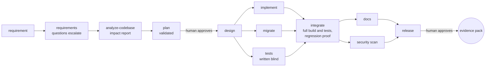

# Agentic SDLC Orchestrator

A governed orchestration system that takes a software requirement through requirements, codebase
analysis, planning, design, implementation, testing, integration, documentation, security scanning and
release readiness. LLM agents do the work inside hard limits; deterministic gates, policy-as-code and
humans decide what is accepted. A URL shortener is the system it builds and changes.

> **Agents propose, gates dispose.** No model ever decides whether a model's work is accepted.

## Try it

Prerequisite: Docker. No API key: everything below replays saved model answers, with no model called.

```bash
docker compose run --rm brownfield   # fix a production bug in an existing service (1–2 min of run time)
docker compose run --rm ambiguous    # unclear request: question escalated, scope changes mid-run, re-plan
docker compose up console            # approval console on http://localhost:8080
docker compose run --rm test         # 120 orchestrator + 105 shortener tests
```

Each run prints its audit timeline, verifies the hash chain, prints reliability metrics and writes an
**evidence pack** to `runs/<run>/evidence/`. The first build and run download Maven dependencies (a few
minutes); later runs reuse them.

**What is scripted.** The replayable cassettes were generated from scripted model answers, not
recorded from a model, and are labelled so. They show the orchestration deterministically. Everything
else in a replay is real: git worktrees and merges, Maven builds and test runs of the whole service,
gates, policy, approvals and the audit log. See [docs/LLM_AND_RUNTIME.md](docs/LLM_AND_RUNTIME.md).

## What it does



- **A DAG engine you can trust with failure.** One coordinator per run; entry and exit gates; parallel
  nodes in their own git worktrees; retries with the failure as feedback; fallback executors;
  compensation and rollback; safe-stop on a kill switch, budget or policy; resume from the log after a
  stop; repairs after a failed merge that re-run only the affected nodes.
- **Gates, not opinions.** Compiler and tests, protected paths, diff size, secrets, applied migrations
  are immutable, a defect fix's new tests must fail on the original code, an in-process security scan. Risky changes
  (migrations, build files, new dependencies, disabled tests) escalate to a human.
- **Humans where it matters.** Plan, migration and release approvals bound to the exact output digest;
  low-confidence requirements escalate as questions; clarifications during execution supersede the
  running plan and produce plan v2.
- **Least privilege in code.** Each agent can write only its paths (`policies/autonomy.yaml`); tests are
  written from the design and contracts before the new implementation exists.
- **Not tied to a model.** Agents call one small `ModelGateway` interface and name model ids from
  configuration. Live mode supports Anthropic or any server with an OpenAI-compatible API (OpenAI,
  Ollama, vLLM, LM Studio), chosen by environment variables; with a local model server no prompt or code
  leaves your machine. Live calls so far have used Anthropic; the OpenAI-compatible path is tested against a
  stub server.
- **Evidence.** Hash-chained audit log, artifact lineage (producer, inputs, model, prompt hash), evidence
  packs that verify offline, run metrics, `/metrics` for Prometheus, and an eval harness for reliability
  across runs.

## The three scenarios

| Scenario | What happens |
| --- | --- |
| **Greenfield** | `pipeline-smoke` builds a small library from nothing in about 15 s (replay); `greenfield` asks real models to build the shortener (live; no complete run recorded yet) |
| **Brownfield** | An incident (duplicate aliases causing 500s) in a released version of the shortener (`scenarios/templates/shortener-v1`): the analysis finds the alias path, the agent's first migration edits an applied migration and is rejected by a gate, the fix and a V3 migration pass the whole existing suite, and the new tests are proven to fail on the original code |
| **Ambiguous** | "Show how many people visit": a privacy question escalates, the product owner answers, then changes scope at design review; the running plan is superseded and re-planned as v2 |

Capability-by-capability map: [docs/SCENARIOS.md](docs/SCENARIOS.md).

## Measured

Replay, 3 runs of each scenario on 2026-10-18 ([full table and notes](docs/results/eval-replay-2026-10-18.md)):

| Scenario | Success | Retries/run | Re-plans/run | Approval decisions/run | Wall p50 |
| --- | --- | --- | --- | --- | --- |
| pipeline-smoke | 100% | 0 | 0 | 2 | 13 s |
| brownfield | 100% | 1 (the deliberate mistake, caught by a gate) | 0 | 3 | 103 s |
| ambiguous | 100% | 1 (requirements redone after the clarification) | 1 | 6 | 115 s |

These measure the orchestrator, not model quality: replay answers are fixed, and approvals were granted
automatically (labelled in the audit log). `docker compose run --rm eval` runs the same eval on your
machine.

## Documentation

| Document | Contents |
| --- | --- |
| [Architecture](docs/ARCHITECTURE.md) | Components, run lifecycle, engine mechanics, gates, policy, agents, workspaces, audit, key decisions |
| [Scenarios](docs/SCENARIOS.md) | Each scenario, how to run it, where each capability is demonstrated, fault injection |
| [Testing](docs/TESTING.md) | Test layers, coverage, drift guards, what is not covered |
| [LLM and runtime](docs/LLM_AND_RUNTIME.md) | Where models are used, choosing a provider and models, run modes, keys, cost, what is sent to a model |
| [Runbook](docs/RUNBOOK.md) | Commands, operating the console, recording, alerts, troubleshooting |
| [Engineering summary](docs/ENGINEERING_SUMMARY.md) | Status, how it was built, limitations and trade-offs, next steps |
| [Shortener](shortener/README.md) | The service: API, design decisions, limitations |

## Repository

```
orchestrator/   the engine, agents, gates, policy, console and CLI (Java 21, Spring Boot 3.4, Spring AI)
shortener/      the URL shortener v1 (Spring Boot, PostgreSQL, Redis)
scenarios/      scenario definitions, cassettes and starting code
policies/       policy-as-code: risk, approvals, protected paths, agent autonomy
ops/            Prometheus scrape config and alert rules
docs/           the documents above and measured results
```

Without Docker: Java 21 and Maven 3.9, then `mvn verify`.
