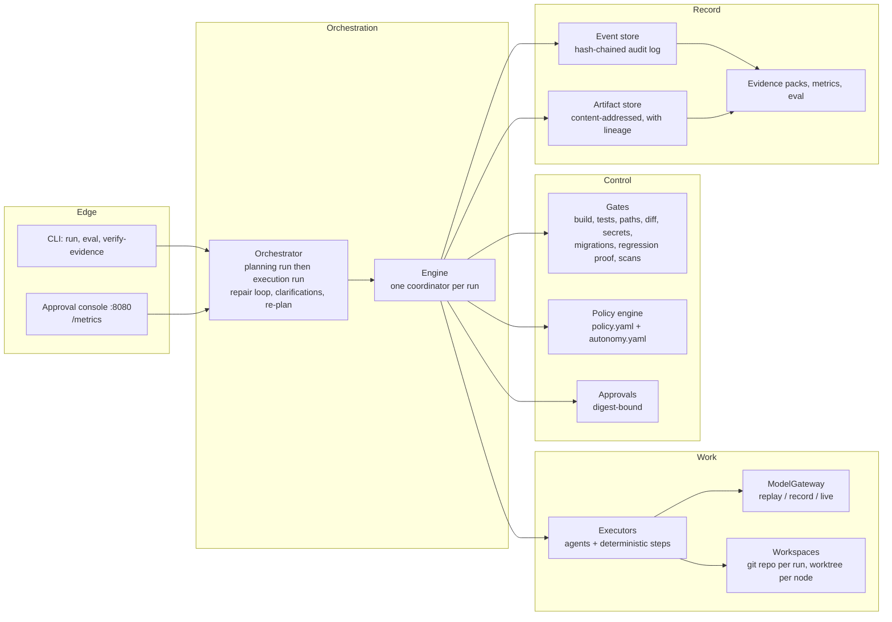
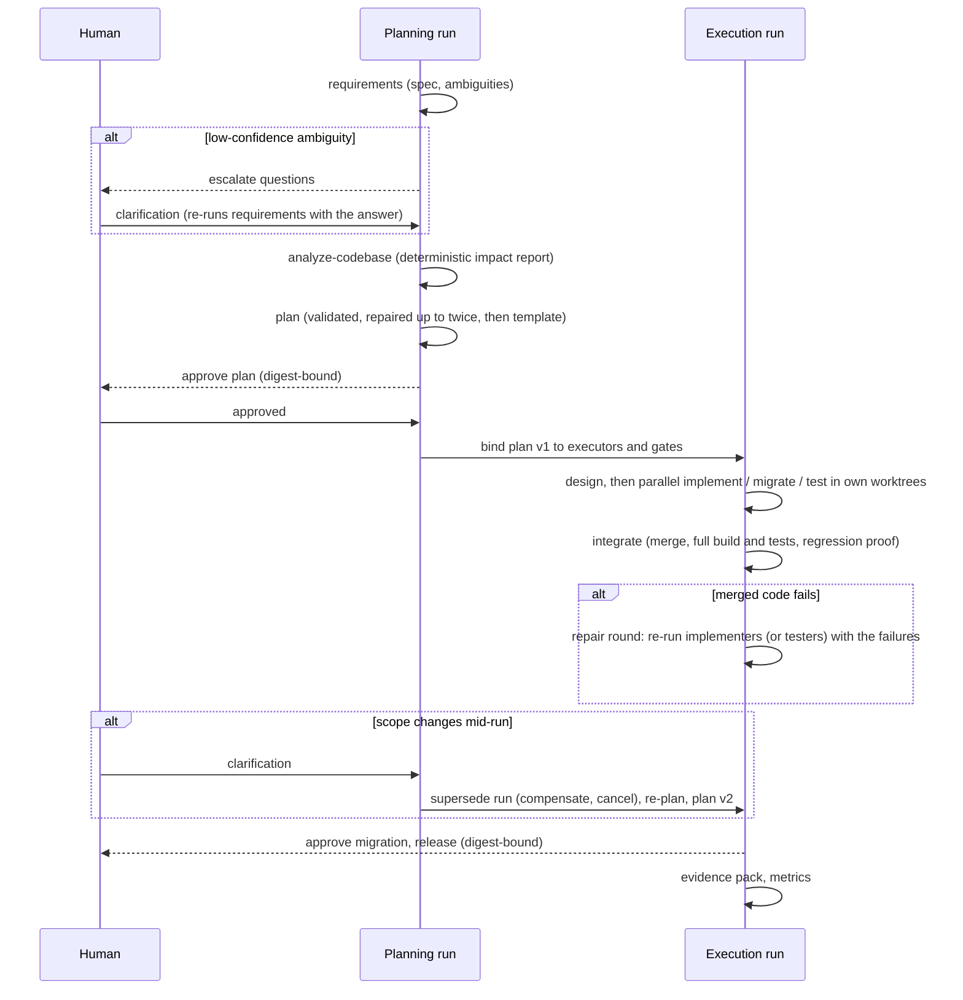

# Architecture

The orchestrator takes a requirement through requirements, codebase analysis, planning, design,
implementation, testing, integration, documentation, security scanning and release readiness. LLM agents
do the creative work; everything that decides whether work is accepted is deterministic code, policy or
a person.

> **Agents propose, gates dispose.** An agent's output is a proposal. A gate (compiler, tests, policy,
> scanners), the policy engine or a human decides whether it is accepted. No LLM ever judges an LLM.

## Principles

| Principle | How it shows up |
| --- | --- |
| Deterministic control plane | The engine, gates, policy, metrics and audit log never call a model. An ArchUnit test fails the build if `gates` or `policy` depend on the `model` package. |
| Everything is an event | Run state is rebuilt from a per-run, hash-chained event log. A stopped or crashed run resumes from the log; metrics and evidence are computed from it. |
| Least privilege, enforced in code | Each agent can write only the paths `policies/autonomy.yaml` gives it. Edits outside them are refused by the tool layer, not by asking the model nicely. |
| Humans decide what is risky | Policy raises risk by node type and by the files a change touches; high-risk output waits for a human, and the approval is bound to the exact output digest. |
| Honest evidence | Replay, record and live modes are labelled everywhere; injected faults and automatic approvals are labelled in the audit log; scripted cassettes say so. |

## Components

| Package | Responsibility | Depends on |
| --- | --- | --- |
| `domain` | Plan (validated DAG, topological order, digest), TaskNode, node status machine, retry policy, budgets | nothing |
| `engine` | Coordinator: scheduling, retries, fallbacks, gates, approvals, compensation, safe-stop, budgets, `markStale`, `supersede`, fault injection | domain, events, artifacts, gates, policy |
| `events` | Event model, hash chain, in-memory and JDBC (PostgreSQL) stores, `AuditVerifier` | domain |
| `artifacts` | Content-addressed artifacts with lineage (producer, attempt, inputs, model, prompt hash) | nothing |
| `gates` | Deterministic exit checks | domain, artifacts |
| `policy` | Risk floors, approval threshold, protected and approval paths, agent autonomy | domain |
| `workspace` | Git repository per run, worktree per node, structured edit application within permissions | gates (for `WorkspaceRef`) |
| `model` | `ModelGateway`, cassettes, replay and recording gateways, Spring AI live gateway | nothing in the engine |
| `agents` | Requirements, planner, architect, coder, tester, docs agents; codebase analyzer; integrate, security scan and release steps | model, workspace, planning |
| `planning` | Requirement spec, plan proposal, plan validator, binder, template planner | domain |
| `codebase` | JavaParser repository index and impact analysis | nothing in the engine |
| `scenario` | Scenario loading, two-stage orchestration, repair loop, clarifications | everything above |
| `metrics`, `evidence`, `eval` | Run metrics, Prometheus exporter, evidence packs, eval harness | events, artifacts |
| `app`, `web`, `demo` | Spring Boot wiring, CLI, approval console, fake-agent demo | everything |

`ArchitectureTest` enforces: the engine packages use no Spring or Jackson; gates and policy never touch
the model package; the engine never depends on the app or demo layers.

## How a scenario runs

1. **Planning run** (fixed shape): `requirements` → `analyze-codebase` → `plan`. The requirements agent
   writes a spec with acceptance criteria and explicit ambiguities. A LOW-confidence ambiguity (privacy,
   retention, security, public API) escalates to a human instead of being guessed. The codebase analyzer
   indexes the starting code and reports what the requirement touches. The planner proposes a DAG that a
   deterministic validator checks; a human approves it.
2. **Execution run** (the approved plan): `PlanBinder` maps each node type to an executor and a gate set;
   the planner chooses the shape, never the gates.
3. **Integration repair**: if the merged code fails its build or tests, the implementation nodes are
   re-run with the failures as feedback (the tests are the specification). If the regression-proof gate
   fails, the test nodes are re-run instead. At most two rounds, then a human decides.
4. **Clarifications and re-planning**: before execution, a clarification re-runs the requirements step.
   During execution, it supersedes the running plan: finished work is compensated, pending nodes are
   cancelled, approvals are invalidated, and the spec, analysis and plan are redone as plan v2 in a new
   execution run.

## The engine

**One coordinator per run** owns every state change. Executors run in parallel on virtual threads (up to
`max-parallel`) and only return results; the coordinator applies them, evaluates gates and emits events.
No shared mutable state between workers.

**Node state machine** (enforced by a transition table, property-tested with jqwik):

`PENDING → READY → RUNNING → VERIFYING → SUCCEEDED`, with `RETRYING`, `AWAITING_APPROVAL`, `FAILED`,
`SKIPPED`, `CANCELLED`, `ROLLED_BACK` and `STALE` branches. Illegal transitions throw.

| Mechanism | Behaviour |
| --- | --- |
| Entry gates | Before a node runs: policy decision (deny fails the node; a critical denial safe-stops the run) and every input artifact present. |
| Exit gates | After each attempt, in order, fail-fast. The first failure becomes the feedback for the next attempt. |
| Retries | Per-node `RetryPolicy` (attempts, backoff). Feedback carries the gate failure, the exception, or the reviewer's rejection; reviewer feedback persists across later attempts. |
| Fallback | A node can list fallback executors; after the primary's attempts are exhausted the next one takes over (`FALLBACK_ACTIVATED`). Used for the planner → template planner. |
| Compensation and rollback | Executors implement `compensate`. A failed node is compensated; `rollback` compensates succeeded nodes newest first. Edit agents reset their branch. |
| Safe-stop | Kill switch, budget breach or critical policy denial cancels in-flight attempts, records why, and leaves the run resumable. |
| Budgets | Wall time, tokens and cost per run; exceeding one safe-stops the run. Budgets can be raised and the run resumed. |
| Approvals | `AWAITING_APPROVAL` pauses the node; the decision must name the output digest it approves. Approving changed output is refused. Automatic approval exists only for unattended demos and labels itself. |
| Re-planning | `markStale(node)` resets a node and everything downstream, invalidating their approvals and reusing the rest. `supersede(run)` ends a run that a new plan replaces. |
| Crash resume | State is rebuilt from the log; nodes in flight at the crash are retried, finished nodes are not redone. |
| Fault injection | `FaultSpec`: an exception or a forced gate failure on given attempts, from the scenario file or `--inject`. Always recorded as `FAULT_INJECTED`. |

## Gates

| Gate | Checks | Bound to |
| --- | --- | --- |
| `outputs-present` | The attempt produced artifacts | every node |
| `no-secrets` | No secret patterns in text outputs | requirements, release |
| `spec-valid` | Spec parses and is complete; LOW-confidence ambiguities **escalate** to a human | requirements |
| `plan-valid` | Every criterion implemented and tested, tests independent of code, one design first, a join before release, release last, at most 15 nodes | plan |
| `protected-paths` | No change to `policies/**`, `Dockerfile`, `docker-compose.yml`, `.github/**`, production config | editing nodes, join |
| `secrets-in-diff` | No secret patterns in added lines | editing nodes |
| `diff-size` | At most 600 changed lines per node | editing nodes |
| `approval-paths` | Migrations, `pom.xml`, `**/security/**` changed: **escalate** | editing nodes |
| `new-dependency` | New dependency names in the build file: **escalate** with the license allowlist | editing nodes |
| `disabled-tests` | Tests disabled or deleted: **escalate** | editing nodes |
| `migrations-immutable` | No change to a migration that exists in the starting code (already applied in production) | editing nodes, join |
| `non-empty-change` | The node actually changed files | design, implement, test |
| `build` | `mvn test-compile` in the node's worktree | design, implement, join |
| `tests` | `mvn test` on the merged code | join |
| `regression-proof` | The run's new tests **fail** on the starting code (defect fixes) | join, when the scenario sets `regressionProof` |
| `security-clean` | Eight in-process rules: hard-coded secrets, API keys, private keys, command execution, Java deserialization, SQL concatenation, CORS wildcard, logging raw client IPs | security scan |

An escalation does not fail the node: it passes the gate and asks a human, with the reason shown in the
approval.

## Policy

`policies/policy.yaml` and `policies/autonomy.yaml` are protected paths: no agent can change them.

- **Risk floors** per node type (DESIGN and IMPLEMENT at least MEDIUM, SCHEMA_MIGRATION and
  RELEASE_READINESS HIGH). Policy can raise the planner's risk, never lower it.
- **Approval threshold**: HIGH and above waits for a human.
- **Protected paths** never change; **approval paths** escalate; **diff limit** 600 lines; **denied
  executors** for incident response.
- **Autonomy**: requirements and planner are read-only. The architect writes contracts and every shared
  file (configuration, `pom.xml`, the error handler) so parallel implementers never collide; the coder
  writes `src/main/java` and migrations; the tester writes `src/test` only; docs writes `README.md` and
  `docs/`.

## Agents

| Agent | Model (live) | Sees | Writes |
| --- | --- | --- | --- |
| requirements | Claude Sonnet 5.5 | the requirement (and clarifications) | a spec (read-only) |
| codebase analyzer | none (deterministic) | the starting code | an impact report |
| planner | Claude Opus 5.5 | spec, impact report | a plan (read-only) |
| architect | Claude Opus 5.5 | everything | design, contracts, shared files |
| coder | Claude Opus 5.5 | design, contracts, all main code | implementation, migrations |
| tester | Claude Sonnet 5.5 | design, contracts, existing tests; **not the implementation** | tests |
| docs | Claude Haiku 5.5 | design, API, config | README, docs |
| integrate, security scan, release | none (deterministic) | the merged branch | merge, scan report, release checklist |

Agents return **structured edits** (`create`, `replace`, `patch` with a unique search string, `delete`),
not unified diffs. The tool layer applies them all-or-nothing inside the agent's writable paths and
commits a real diff for the gates and the approver. Each agent's context bundle is built from the files
its role may see, with the impact report's files first, and a manifest records what was included or cut.

**Blind tests.** The tester works in a worktree that does not contain the implementation, from the design
and the criteria only. Its tests can only compile once merged at the JOIN, which is where they must pass.

## Workspaces

Each run gets a git repository seeded from the scenario's starting code (OS metadata files excluded).
Each node gets its own worktree and branch, starting from the merge of its dependencies' commits, so
parallel nodes never see each other's half-done work and the JOIN is where their changes meet. A merge
conflict fails the JOIN with the conflicting files named. Compensation resets a node's branch. Git
metadata operations are serialized per run; builds in different worktrees run in parallel.

## Model gateway and record/replay

Every model call goes through `ModelGateway`. The request key is
`sha256(model, system prompt, user prompt, parameters)`.

- **replay** (default): answers come from the scenario's `cassette.jsonl`. A missing key fails the attempt
  with "cassette miss: re-record this scenario"; replay never falls back to a live call. Replayed answers
  report zero tokens and cost.
- **record**: live calls, each exchange appended to the cassette as it happens.
- **live**: Spring AI's Anthropic client, built by hand (no autoconfiguration, so replay never needs a
  key), with retries on transient errors. Thinking blocks are skipped; a `max_tokens` stop is reported as
  truncation with an actionable message instead of a JSON parse error.

Prompts are versioned files (`prompts/*.md`, each with a `version:` line; planner and edit-agent are at v2); the prompt id and hash are stored on every
artifact, so a prompt change is visible in lineage and invalidates cassettes.

## Audit, lineage and evidence

- **Audit log**: every state change, gate result, approval, clarification, fault, compensation, token
  count and decision is an event. Each event's hash covers its content and the previous hash;
  `AuditVerifier` detects any edit, removal or reordering. In memory by default; PostgreSQL with the
  `postgres` profile.
- **Lineage**: every artifact records its producer node and attempt, executor, input artifact hashes,
  model and prompt hash.
- **Evidence pack** (after every run): a README (runs, plan versions, per-node gates, human input,
  failures and recoveries, agent decisions, metrics), the audit logs as JSONL, every artifact with its
  lineage, the final diff against the starting code and the metrics. `verify-evidence` re-checks the
  hash chains from those files alone.

## Observability

- `RunMetrics` from the log: attempts and failures, retries, fallbacks, rollbacks, compensations,
  injected faults, approvals, recovered nodes, MTTR with and without human wait, end-to-end time,
  tokens, cost.
- `GET /metrics` on the console: the same in Prometheus format, computed at scrape time.
- The shortener exposes `/actuator/prometheus` (HTTP latency, click pipeline, cache).
- `ops/prometheus/alerts.yml`: broken audit chain, approval waiting 30 minutes, gate failure rate,
  dropped clicks, cache errors, p99 redirect latency.
- The eval harness turns N complete scenario runs into success rate, retries, recoveries, re-plans and
  latency percentiles.

## Key decisions

| Decision | Alternatives | Why |
| --- | --- | --- |
| Own engine, event-sourced | Temporal, LangGraph, Airflow | The orchestration layer is the product; owning it keeps every mechanism visible and testable. Event sourcing gives resume, audit and metrics from one source. |
| Deterministic gates only | LLM-as-judge | A model judging a model is not a control. Gates must be reproducible. |
| Structured edits | Unified diffs from the model | Diffs from models often fail to apply; structured edits are validated and applied all-or-nothing. |
| Worktree per node | One shared checkout | Parallel work without interference; every node's change is a reviewable commit. |
| Blind tests | Tests written after the code | Tests derived from the criteria, not the implementation, catch the implementation being wrong. |
| Record/replay | Live-only demos | Anyone can run everything offline, deterministically and for free; live mode measures the models. |
| Two-stage runs | One DAG including planning | The plan is itself reviewed and approved before any code is written. |
| Java 21, Spring Boot, Spring AI | Python agent frameworks | Matches the author's stack; virtual threads make the parallel coordinator simple. |
